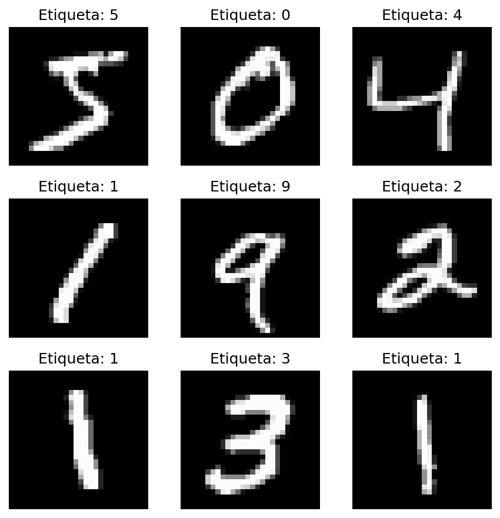
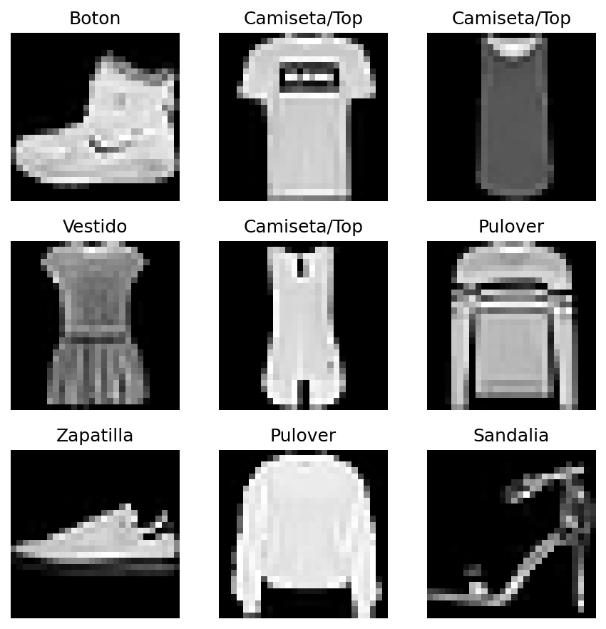

# Laboratorio 05 — Arquitecturas CNN y Análisis de Resultados (MNIST vs. Fashion-MNIST)

**Asignatura:** SIS070 - Inteligencia Artificial
**Grupo:** 03
**Repositorio:** https://github.com/JAZAgT/IA_Guia05__cnn_RGZO

## 1. Descripción

Implementación y comparación de dos Redes Neuronales Convolucionales (CNN) con **TensorFlow/Keras**, entrenadas sobre dos dominios visuales distintos:

- **`mnist_cnn.py`** (Parte 1): clasifica dígitos escritos a mano (0-9) del dataset **MNIST**.
- **`fashion_cnn.py`** (Parte 2): clasifica prendas de vestir (10 categorías) del dataset **Fashion-MNIST**, con la capa densa oculta ampliada de 64 a 128 neuronas.

Ambos scripts cargan su dataset, visualizan 9 muestras de ejemplo con `matplotlib`, construyen la misma arquitectura base (2 bloques Conv2D + MaxPooling2D, Flatten, y 2 capas densas con salida Softmax), entrenan 1 época de demostración sobre 5000 muestras, y analizan la predicción del modelo sobre una imagen de prueba.

## 2. Estructura del proyecto

```
practica-cnn-comparativa/
├── mnist_cnn.py        # Parte 1: CNN con digitos (MNIST)
├── fashion_cnn.py      # Parte 2: CNN con prendas (Fashion-MNIST)
├── img/                 # Visualizaciones de cada dataset (ver Seccion 4)
│   ├── visualizacion_mnist.png
│   └── visualizacion_fashion.png
├── README.md
├── requirements.txt
└── .gitignore
```

## 3. Instrucciones de ejecución

```bash
pip install -r requirements.txt
python mnist_cnn.py
python fashion_cnn.py
```

Cada script abre una ventana con 9 imágenes de ejemplo del dataset correspondiente (y además guarda esa misma imagen en `img/`), imprime el `model.summary()`, entrena 1 época sobre 5000 muestras y finalmente imprime el vector de probabilidades (Softmax) de una predicción de prueba.

## 4. Modificaciones realizadas respecto a la guía (y por qué)

Al transcribir y probar el código de la guía se encontraron 2 situaciones que requirieron intervención:

1. **Error de sintaxis real en `fashion_cnn.py` (corregido).** La última línea de impresión de la guía es:

   ```python
   print(f"Clase real: {class_names[y_test[0]]} (índice {y_test[0]})} ")
   ```

   Esta línea tiene una llave de cierre `}` sobrante después de `(índice {y_test[0]})`, lo cual es un **`SyntaxError: f-string: single '}' is not allowed`** en Python — el script ni siquiera llega a ejecutarse. Lo verificamos de forma aislada antes de tocar nuestro archivo, reproduciendo el error exacto. La corrección fue simplemente eliminar esa llave sobrante:

   ```python
   print(f"Clase real: {class_names[y_test[0]]} (indice {y_test[0]})")
   ```

2. **Se agregó `plt.savefig(...)` antes de cada `plt.show()` (adición, no corrección).** La guía solo pide `plt.show()`, que abre una ventana interactiva — útil para inspeccionar el dataset en vivo, pero imposible de incluir como evidencia dentro de este README o del informe en Word. Por eso, en ambos scripts, justo antes de `plt.show()`, se agregó:

   ```python
   os.makedirs('img', exist_ok=True)
   plt.savefig('img/visualizacion_mnist.png', dpi=150, bbox_inches='tight')  # (o visualizacion_fashion.png)
   ```

   `plt.show()` se mantiene intacto tal como pide la guía: en un entorno interactivo normal (la terminal de un estudiante en su propia máquina) seguirá abriendo la ventana con la cuadrícula de imágenes exactamente como se describe. Para nuestra ejecución reproducible de evidencia (ver Sección 5) usamos el backend no interactivo `Agg` de matplotlib (`MPLBACKEND=Agg`), que hace que `plt.show()` no bloquee la terminal esperando que alguien cierre una ventana manualmente; la figura es idéntica, solo que se guarda en archivo en lugar de mostrarse en pantalla.

Fuera de estos 2 puntos, no fue necesario modificar la arquitectura, el preprocesamiento, el entrenamiento ni la lógica de predicción: ambos scripts siguen exactamente lo especificado en la guía.

## 5. Resultados — Parte 1: MNIST

### 5.1 Visualización del dataset

**Figura 1.** *Muestras del dataset MNIST (`img/visualizacion_mnist.png`).*

*Nota.* Los dígitos se ven como trazos blancos simples sobre fondo negro, centrados y de grosor relativamente uniforme. Inspeccionar visualmente los datos crudos antes de entrenar permite confirmar que las etiquetas corresponden a la imagen real, detectar ruido o imágenes corruptas, y entender la variabilidad de trazo (grosor, inclinación, estilo) que la CNN deberá aprender a tolerar.

### 5.2 Salida real de consola (`python mnist_cnn.py`)

```
--- [PARTE 1] INICIO DE EJECUCION: MNIST ---

--- Mostrando imagenes de ejemplo del dataset MNIST ---
Model: "sequential"
+--------------------------------------------------------------------------+
| Layer (type)                    | Output Shape           |       Param # |
|---------------------------------+------------------------+---------------|
| Conv_1 (Conv2D)                 | (None, 26, 26, 32)     |           320 |
|---------------------------------+------------------------+---------------|
| MaxPool_1 (MaxPooling2D)        | (None, 13, 13, 32)     |             0 |
|---------------------------------+------------------------+---------------|
| Conv_2 (Conv2D)                 | (None, 11, 11, 64)     |        18,496 |
|---------------------------------+------------------------+---------------|
| MaxPool_2 (MaxPooling2D)        | (None, 5, 5, 64)       |             0 |
|---------------------------------+------------------------+---------------|
| Aplanado_Flatten (Flatten)      | (None, 1600)           |             0 |
|---------------------------------+------------------------+---------------|
| Capa_Densa_Oculta (Dense)       | (None, 64)             |       102,464 |
|---------------------------------+------------------------+---------------|
| Salida_Softmax (Dense)          | (None, 10)             |           650 |
+--------------------------------------------------------------------------+
 Total params: 121,930 (476.29 KB)
 Trainable params: 121,930 (476.29 KB)
 Non-trainable params: 0 (0.00 B)

--- Entrenando el modelo MNIST (5000 muestras, 1 epoca) ---
79/79 ━━━━━━━━━━━━━━━━━━━━ 1s 6ms/step - accuracy: 0.7512 - loss: 0.8471

--- Analizando Resultados de Prediccion (MNIST) ---
Vector de probabilidades crudas (Softmax):
[0.000e+00 0.000e+00 0.000e+00 1.600e-03 0.000e+00 1.000e-04 0.000e+00
 9.971e-01 0.000e+00 1.200e-03]
Clase predicha por el modelo: 7
Clase real de la imagen: 7
```

### 5.3 Actividades de análisis (Parte 1)

**1. Inspección visual del dataset.** Ver Sección 5.1. Los dígitos se ven como trazos simples, blancos sobre negro, bien centrados en el lienzo de 28×28. Entender visualmente los datos crudos es útil porque permite anticipar qué tan fácil o difícil será la tarea para la red (trazos simples y consistentes sugieren un problema relativamente sencillo), verificar que las etiquetas sean correctas, y decidir si hace falta algún preprocesamiento adicional (en este caso, basta con normalizar).

**2. `model.summary()` y shapes.** La imagen de entrada es de 28×28 píxeles. `Conv_1` usa un kernel de 3×3 **sin padding** (`padding='valid'`, el valor por defecto en Keras cuando no se especifica), por lo que el kernel solo puede deslizarse dentro de los límites de la imagen: el tamaño de salida es `tamaño_entrada - tamaño_kernel + 1 = 28 - 3 + 1 = 26`. De ahí que la salida de `Conv_1` sea `(26, 26, 32)` (32 es la cantidad de filtros, no una dimensión espacial). Luego, `MaxPool_1` usa una ventana de agrupamiento de 2×2, que reduce cada dimensión espacial a la mitad: `26 / 2 = 13`, dando la forma `(13, 13, 32)` que se ve en el resumen.

**3. Análisis de parámetros y Flatten.** Los parámetros entrenables de `Conv_2` provienen de sus filtros: cada uno de los 64 filtros de `Conv_2` tiene un kernel de 3×3 que se aplica sobre los **32 canales** que entrega `MaxPool_1` (no solo 1 canal), más un sesgo (bias) por filtro. Es decir: `(3 × 3 × 32 + 1) × 64 = (288 + 1) × 64 = 289 × 64 = 18 496`, exactamente el valor que aparece en el resumen. La capa `Flatten` cumple la función de **puente estructural**: convierte el mapa de características tridimensional que entrega `MaxPool_2`, de forma `(5, 5, 64)`, en un vector unidimensional de `5 × 5 × 64 = 1600` valores (tal como muestra `Aplanado_Flatten`), porque las capas `Dense` que siguen solo aceptan vectores planos, no tensores espaciales.

**4. Interpretación del vector Softmax.** El vector impreso, `[0, 0, 0, 0.0016, 0, 0.0001, 0, 0.9971, 0, 0.0012]`, tiene 10 valores — uno por cada dígito posible (0 al 9) — y al sumarlos da **1.0**, porque la función Softmax normaliza las salidas de la red para que representen una distribución de probabilidad válida sobre las clases. `np.argmax()` recorre el vector y devuelve el **índice** de la posición con el valor más alto; en este caso, el índice 7 (valor 0.9971), por lo que la clase predicha es el dígito **7**. Al contrastarlo con `y_test[0]`, la etiqueta real de esa imagen, que también es **7**, confirmamos que la predicción fue correcta, y además con una confianza muy alta (99.71%).

## 6. Resultados — Parte 2: Fashion-MNIST

### 6.1 Visualización del dataset

**Figura 2.** *Muestras del dataset Fashion-MNIST (`img/visualizacion_fashion.png`).*

*Nota.* A diferencia de los dígitos, las prendas presentan siluetas más complejas, con texturas internas (botones, costuras, estampados), proporciones variadas y, en varios casos, orientaciones o formas que se parecen entre categorías distintas (por ejemplo, una zapatilla y una sandalia comparten la silueta general de calzado).

### 6.2 Salida real de consola (`python fashion_cnn.py`)

```
--- [PARTE 2] INICIO DE EJECUCION: FASHION-MNIST ---

--- Mostrando imagenes de ejemplo del dataset Fashion-MNIST ---
Model: "sequential"
+--------------------------------------------------------------------------+
| Layer (type)                    | Output Shape           |       Param # |
|---------------------------------+------------------------+---------------|
| Conv_1 (Conv2D)                 | (None, 26, 26, 32)     |           320 |
|---------------------------------+------------------------+---------------|
| MaxPool_1 (MaxPooling2D)        | (None, 13, 13, 32)     |             0 |
|---------------------------------+------------------------+---------------|
| Conv_2 (Conv2D)                 | (None, 11, 11, 64)     |        18,496 |
|---------------------------------+------------------------+---------------|
| MaxPool_2 (MaxPooling2D)        | (None, 5, 5, 64)       |             0 |
|---------------------------------+------------------------+---------------|
| Aplanado_Flatten (Flatten)      | (None, 1600)           |             0 |
|---------------------------------+------------------------+---------------|
| Capa_Densa_Oculta (Dense)       | (None, 128)            |       204,928 |
|---------------------------------+------------------------+---------------|
| Salida_Softmax (Dense)          | (None, 10)             |         1,290 |
+--------------------------------------------------------------------------+
 Total params: 225,034 (879.04 KB)
 Trainable params: 225,034 (879.04 KB)
 Non-trainable params: 0 (0.00 B)

--- Entrenando el modelo Fashion-MNIST (5000 muestras, 1 epoca) ---
79/79 ━━━━━━━━━━━━━━━━━━━━ 1s 6ms/step - accuracy: 0.6580 - loss: 1.0273

--- Analizando Resultados de Prediccion (Fashion-MNIST) ---
Vector de probabilidades crudas (Softmax):
[3.000e-04 0.000e+00 4.000e-04 4.000e-04 1.800e-03 3.460e-02 9.000e-04
 2.917e-01 1.560e-02 6.543e-01]
Clase predicha: Boton (indice 9)
Clase real: Boton (indice 9)
```

### 6.3 Actividades de análisis (Parte 2)

**1. Inspección visual del dataset.** Ver Sección 6.1. Frente a los trazos simples y centrados de MNIST, las prendas de Fashion-MNIST muestran siluetas más complejas: formas irregulares, texturas internas y mayor variabilidad entre muestras de una misma categoría (una "camiseta/top" puede verse muy distinta de otra). Esta mayor complejidad visual hace que la tarea de clasificación sea intrínsecamente más difícil que reconocer dígitos.

**2. `class_names` y la salida nominal.** La red internamente solo predice un **índice numérico** entre 0 y 9 (la posición del valor más alto del vector Softmax); ese número por sí solo no le dice nada a una persona. El arreglo `class_names` actúa como una tabla de traducción: `class_names[indice_predicho]` convierte ese entero abstracto en una etiqueta legible (por ejemplo, el índice 9 se traduce a `"Boton"`, que en este dataset corresponde a la categoría de botines/calzado de caña alta), permitiendo interpretar el resultado del modelo en términos humanos en lugar de códigos numéricos.

**3. Impacto de la capa densa ampliada (64 → 128).** Ampliar `Capa_Densa_Oculta` de 64 a 128 neuronas no afecta a las capas convolucionales (siguen teniendo 320 y 18 496 parámetros, idénticos a MNIST), pero sí a las 2 capas densas que dependen de su tamaño: `Capa_Densa_Oculta` pasa de `1600 × 64 + 64 = 102 464` a `1600 × 128 + 128 = 204 928` parámetros, y `Salida_Softmax` pasa de `64 × 10 + 10 = 650` a `128 × 10 + 10 = 1290`, porque ahora recibe 128 entradas en vez de 64. En total, el modelo de Fashion-MNIST tiene **225 034** parámetros frente a los **121 930** de MNIST — un **84.6% más**. Duplicar la capacidad de la capa densa tiene sentido aquí porque los patrones visuales de las prendas (texturas, siluetas variadas) son más complejos que los de los dígitos, y una capa más ancha le da a la red más combinaciones posibles de las características extraídas por las convoluciones para separar las 10 categorías.

## 7. Parte 3 — Análisis comparativo entre ambos dominios

### 7.1 Aclaración: Accuracy del entrenamiento vs. Confianza de una predicción individual

Antes de comparar los resultados, conviene aclarar la diferencia entre 2 métricas que aparecen en este informe y que, aunque ambas se expresen como porcentajes, **no miden lo mismo**.

**Accuracy (precisión del entrenamiento, 75.12% / 65.80%).** Es una métrica **agregada**: representa el porcentaje de aciertos del modelo sobre las 5000 muestras de entrenamiento, promediado a lo largo de los 79 batches de la única época. Como los pesos de la red se van actualizando batch a batch, ese promedio mezcla los aciertos de los primeros batches (cuando el modelo apenas comenzaba a aprender, con pesos casi aleatorios) con los de los últimos (cuando ya había mejorado algo). Por eso, con solo **1 época** y **5000 muestras** (en vez de las 60 000 disponibles en cada dataset), un accuracy de 75.12% (MNIST) o 65.80% (Fashion-MNIST) es un resultado **esperado y razonable para una demostración rápida**, no el de un modelo final optimizado: entrenando más épocas sobre el dataset completo, esta misma arquitectura suele superar el 98% en MNIST y el 88-90% en Fashion-MNIST.

**Confianza de una predicción individual (99.71% / 65.43%, el valor máximo del vector Softmax).** Es una métrica **puntual**: corresponde a una sola imagen de prueba (`X_test[0]`), nunca vista durante el entrenamiento, y no es ningún promedio. Representa qué tan convencida está la red, ya entrenada tras la época, de su propia respuesta para ese caso particular.

Que el accuracy del entrenamiento sea moderado y que, al mismo tiempo, la confianza en una predicción puntual sea muy alta **no es contradictorio**: el modelo puede fallar en una parte de las imágenes en general, pero frente a una imagen puntual especialmente clara (como el dígito 7 analizado) puede estar muy seguro y acertar. Es equivalente a decir que alguien acierta el 75% de las preguntas de un examen, pero en una pregunta puntual estaba 99% seguro de su respuesta y la acertó: una mide el desempeño **general** del modelo, la otra la **certeza en un caso individual**, y son escalas independientes entre sí.

### 7.2 Comparativa de métricas, complejidad visual y distribución de confianza

**1. Comparativa de métricas de entrenamiento.** Tras la única época de entrenamiento, MNIST alcanzó una **precisión de 75.12%** con una **pérdida de 0.8471**, mientras que Fashion-MNIST alcanzó **65.80%** de precisión con una **pérdida de 1.0273**. La red aprende de forma más rápida y eficiente sobre MNIST: con el mismo número de muestras (5000), el mismo número de pasos (79 batches) y la misma arquitectura base, el modelo de dígitos ya clasifica correctamente a 3 de cada 4 ejemplos, mientras que el de prendas apenas supera los 3 de cada 5. Esto es consistente con que los dígitos son patrones visuales más simples y uniformes de aprender que las prendas de vestir.

**2. Complejidad visual y de patrones.** Los dígitos de MNIST son trazos simples, centrados y de grosor relativamente constante — básicamente curvas y líneas sobre un fondo uniforme. Las prendas de Fashion-MNIST, en cambio, tienen siluetas completas, texturas internas y formas que varían mucho según el ángulo o el estilo de la prenda (comparar una "camiseta/top" plana con un "pulóver" con mangas). Esta mayor complejidad se refleja directamente en la confianza del vector Softmax: para MNIST, la red asignó **99.71%** de probabilidad a la clase correcta, prácticamente sin ambigüedad; para Fashion-MNIST, la clase correcta ("Botón"/calzado) obtuvo solo **65.43%**, con una porción no despreciable de probabilidad repartida en clases visualmente parecidas.

**3. Distribución de confianza del modelo.** En MNIST se observa una probabilidad **fuertemente dominante** hacia una única clase (99.71% para el dígito 7, el resto prácticamente en cero). En Fashion-MNIST la distribución es notablemente **más dispersa**: además del 65.43% para la clase correcta ("Botón"), el vector asigna 29.17% a "Zapatilla" y 3.46% a "Sandalia" — es decir, casi toda la incertidumbre del modelo se concentra en las otras 2 categorías de calzado, no en clases aleatorias. Esto demuestra que el dominio de los datos repercute directamente en la certeza de la red: cuando las clases son visualmente muy distintas entre sí (los 10 dígitos), la red puede volverse muy segura rápidamente; cuando varias clases comparten características visuales (botín, zapatilla y sandalia son todas tipos de calzado), la red reparte probabilidad entre ellas incluso cuando acierta la predicción final.

## 8. Conclusiones

- **MNIST es un problema más sencillo que Fashion-MNIST** para esta misma arquitectura: en 1 sola época, MNIST ya logra 75.12% de precisión frente al 65.80% de Fashion-MNIST, con menor pérdida.
- **El accuracy del entrenamiento y la confianza de una predicción individual son métricas distintas** (ver Sección 7.1): la primera es un promedio agregado sobre 5000 muestras en 1 época (por eso es moderada), mientras que la segunda es la certeza del modelo ya entrenado frente a un único caso puntual; que una sea moderada y la otra muy alta no es ninguna contradicción.
- **La complejidad visual del dominio se refleja en la confianza del modelo**: dígitos simples producen distribuciones Softmax casi binarias (una clase cercana al 100%); prendas con siluetas superpuestas (calzado) producen distribuciones más repartidas entre las clases visualmente similares.
- **Ampliar la capa densa oculta (64→128) aumenta considerablemente los parámetros entrenables** (+84.6%) sin tocar la parte convolucional, una decisión razonable para un dominio visualmente más complejo.
- El único problema real encontrado en el código proporcionado fue un **error de sintaxis** en la última línea de `fashion_cnn.py` (llave sobrante en un f-string), corregido y documentado en la Sección 4; el resto de la arquitectura, entrenamiento y lógica de predicción de la guía funcionan exactamente como se describen.
